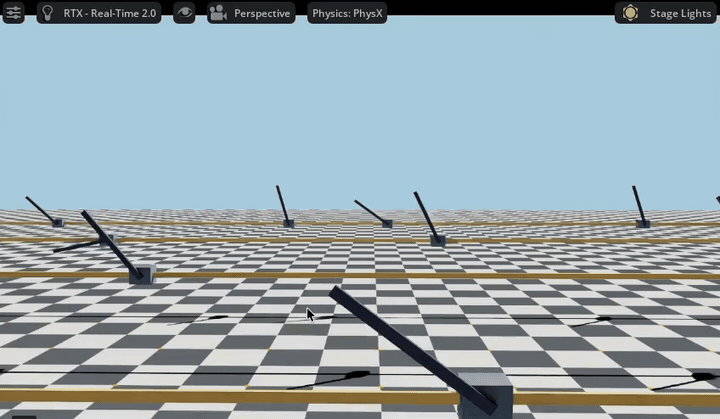
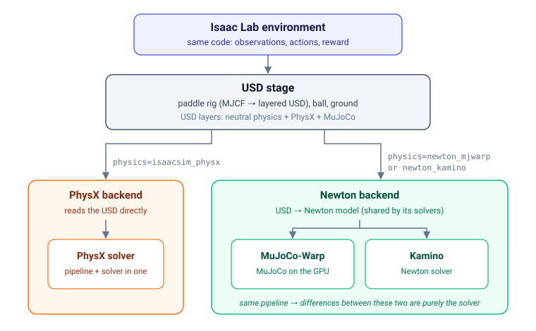
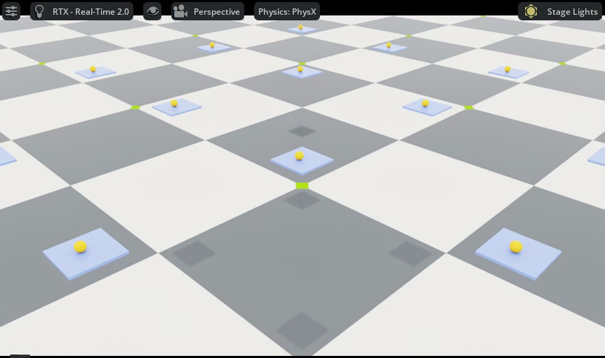
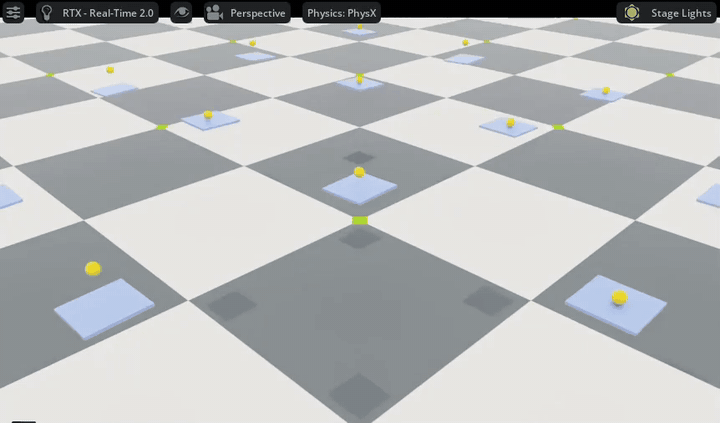
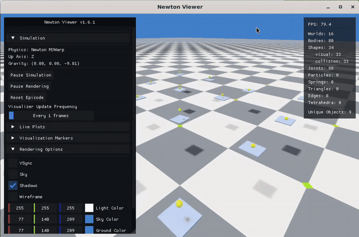
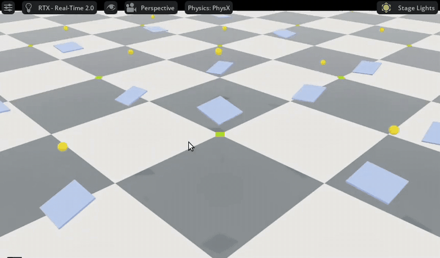

## Motivation / Background

I spent the last 1.5 years at Amazon Robotics on the team responsible for robotic simulation. As an SDE, I worked across the Omniverse stack, USD, and building simulated environments in software like Unity. Naturally when working in “Big Tech”, I worked on specific, small parts of the pipeline.

**Goal:** See the end-to-end flow of preparing assets, choosing a physics engine, tinkering with an RL policy, and finally examining the Sim2Sim gap.\
Get a better idea of industry standards outside Amazon internal tooling.

## Preamble

At Amazon, my team owned a service to provision GPU-enabled cloud instances immediately equipped with simulation tooling. But since we are operating outside the internal Amazon ecosystem, we will need to do things the old-fashioned way.

I chose AWS because I’m most familiar with it, using a g6e.2xlarge type instance.

After gaining a quota from AWS for g6e type instances and wrestling with DCV and some driver mismatches in the base Isaac Sim AMI, I’m in with a working Cartpole trained on PhysX (basically the “Hello World” of RL training in Isaac Lab).



## Plan

We will train a PPO policy to bounce a ball on a paddle as many times as possible in Isaac Lab. Then, staying in Isaac Lab, we'll swap the physics engine underneath that same policy to MuJoCo-Warp and Kamino to observe the Sim2Sim gap. Finally, we'll train a policy on MuJoCo-Warp and see how it holds up on PhysX.

Isaac Lab 3.0 can run the same environment on PhysX, MuJoCo-Warp, and Kamino with one setting, which is a great convenience for this experiment.



Observing the Sim2Sim gap will thus be observing gaps from the conversion pipeline and the physics between the engines.

## Assets

The rig was written in MJCF (MuJoCo’s format), and Isaac Lab converts it to a layered Universal Scene Description (USD) file.

Our assets are simple and generated by LLM. We just have a paddle, three joints that control the height, roll, and pitch of the paddle, and a ball.

## Building the RL model

I opted to use AI for most of the scaffolding.

The action space is the set of all possible joint positions and we define the relative center of each run as the center of the paddle at its home (starting) position.

| Piece | Choice |
|---|---|
| Actions (3) | Target positions for height, roll and pitch, normalized to [-1, 1] and scaled to the joint limits |
| Observations (15) | Ball position (relative to the paddle's home position) and velocity, the joints' positions and velocities, and the previous action |
| Episode | Ball dropped from 20–40 cm above a level paddle; 20 s time-out |
| Training | PPO (RSL-RL), 4,096 parallel environments, 96×96 network, γ = 0.99, exploration noise 0.3 |

We first trained the policy on PhysX; the other engines come later.

Our reward function to start will be simple, +1 per bounce, -10 for dropping the ball. The episode times out after 20 seconds.[^1]

The first iteration led to the paddle wildly bouncing the ball. It averaged about 1 bounce per episode (the 1 free starting bounce), for a reward of about -9. It also found its first cheat, something called **reward hacking**: flinging the ball high, because future rewards are discounted, so a −10 that arrives later costs less, and delaying the drop paid better than learning to bounce.

I’ll gloss over the tuning as that isn’t the focus here. I eventually settled on immediate penalties when the ball leaves the column space above the paddle, along with reducing exploration noise from 1.0 -> 0.3 to discourage the paddle from shaking wildly. This resulted in the paddle learning to just hold the ball, bouncing it incredibly lightly. This was a second case of reward hacking. My bounce rule only checked that the ball's vertical velocity flipped from down to up, so every tiny jitter of the ball on a vibrating paddle counted as a "bounce". The policy racked up hundreds of these fake bounces per episode, driving up its own reward.



Finally, after redefining a bounce as the ball leaving the paddle fast enough to rise at least 5 cm, our policy began to exhibit desired behavior.



| Piece | Final choice |
|---|---|
| Failure | Ball drops below the paddle, or leaves the column above it |
| Reward | +1 per bounce of at least 5 cm, −10 on failure, plus a small reward (up to 0.04 per step) for keeping the ball centered |

```python
# A bounce counts only if the ball leaves the paddle at >= 1 m/s (about a 5 cm bounce)
bounced = (prev_ball_vz < 1.0) & (ball_vz >= 1.0)

# Failure: the ball drops below the paddle, or leaves the column above it
terminated = below_paddle | left_column

reward = 1.0 * bounced - 10.0 * terminated + 0.04 * centered
```

## The engine swap

As mentioned before, swapping the physics engine risks changes in the simulation's physics math, and data from our original assets being lost.

This is how our PhysX policy looks in MuJoCo-Warp:



| Engine | Bounces per episode | Survival |
|---|---|---|
| PhysX | 102 | 97.7% |
| MuJoCo-Warp | 55 | 100% |
| Kamino | 33 | 100% |

The issue is the bounciness: we added an inherent bounciness (restitution)[^2] value to the ball that was lost in the solvers, not the conversion. The policy still knows to ‘lift’ a ball up, which allows it to maintain some bouncing.

To confirm it, I dropped the ball from 30 cm onto a motionless paddle, with no policy, on each engine:

| Engine | Bounces back? | Effective restitution |
|---|---|---|
| PhysX | Yes: 30 → 23 → 18 → 14 cm | 0.88 (configured 0.9) |
| MuJoCo-Warp | No, lands dead (and sinks about 1–1.6 cm into the paddle) | 0 |
| Kamino | No, lands dead | 0 |

On MuJoCo-Warp the resting ball also slowly drifted sideways and then launched itself after about a second, a separate contact instability.

Investigation showed that Newton's model preserved the bounciness, but MuJoCo-Warp can’t express restitution.

```bash
./isaaclab.sh -p ~/paddle-bounce/scripts/inspect_contact_materials.py --engine newton_mjwarp
```

```json
"newton_model_shapes": [
  {"shape": ".../GroundPlane/CollisionPlane", "restitution": 0.0},
  {"shape": ".../paddle/paddle",              "restitution": 0.0},
  {"shape": ".../Ball/geometry/mesh",         "restitution": 0.9}
],
"mujoco_geoms": [
  {"geom": ".../GroundPlane/CollisionPlane_0", "solref": [0.02, 1.0]},
  {"geom": ".../paddle/paddle_1",              "solref": [0.02, 1.0]},
  {"geom": ".../Ball/geometry/mesh_2",         "solref": [0.02, 1.0]}
]
```

Kamino is different. It does understand restitution, but it has to combine two surfaces' values into one, and by default it takes the minimum. The inspection showed Kamino's model stored the ball's 0.9, but it compares with the paddle's 0, and min(0.9, 0) = 0. So effectively, MuJoCo-Warp and Kamino treat the bounce the same.

## Training in the reverse

We used the same parameters to train a policy on MuJoCo-Warp, then switched the physics engine back to PhysX to test it.



| Engine | Bounces per episode | Survival |
|---|---|---|
| MuJoCo-Warp | 90 | 99.6% |
| Kamino | 45 | 100% |
| PhysX | 1.2 | 1.6% |

It fails because, as mentioned before, MuJoCo-Warp has no inherent bounciness, and PhysX brings it back. Trained on a contact that returns no energy, the policy learned to throw the ball hard with the paddle. On PhysX, the ball’s own rebound (about 88% of its incoming speed) stacks on top of that throw, so the bouncing becomes erratic. The ball rides much higher than anything the policy saw in training (19 cm above the paddle on average, vs. 3.7 cm on MuJoCo-Warp) and is lost within about half a second. The policy never learned to avoid actions that lead to this, because on MuJoCo-Warp and Kamino, with no bounciness, that kind of erratic bouncing doesn’t happen.

This revealed that the transfer is asymmetric: the PhysX-trained policy held up on MuJoCo-Warp (fewer bounces, but it never dropped the ball), while the MuJoCo-Warp-trained policy failed almost immediately on PhysX.

*Caveats: each policy comes from a single training run (one random seed), and each result is from 256 parallel environments running one 20-second episode. Bounce counts only include bounces of at least 5 cm.*

## Conclusion

We set out to see the whole flow end to end: assets, physics engine, an RL policy, and the Sim2Sim gap. The reward function was particularly important; the policy found two ways to cheat the reward function before learning to bounce.

The engine swap showed that "changing the physics engine" is really two changes, the conversion and the solver. The solvers ended up dropping bounciness, a key attribute that affected how the policy is trained. Randomizing restitution during training could make the policy more robust to different solvers.

[^1]: A bounce is counted when the ball's vertical velocity flips from downward to upward. Dropping the ball means the ball's center falls below the paddle's center; the episode ends there with the −10.
[^2]: Restitution is the fraction of its speed a ball keeps when it bounces: 1.0 is perfectly bouncy, 0 means it lands dead. It belongs to the pair of surfaces, so the engine combines the ball's value with the paddle's.
